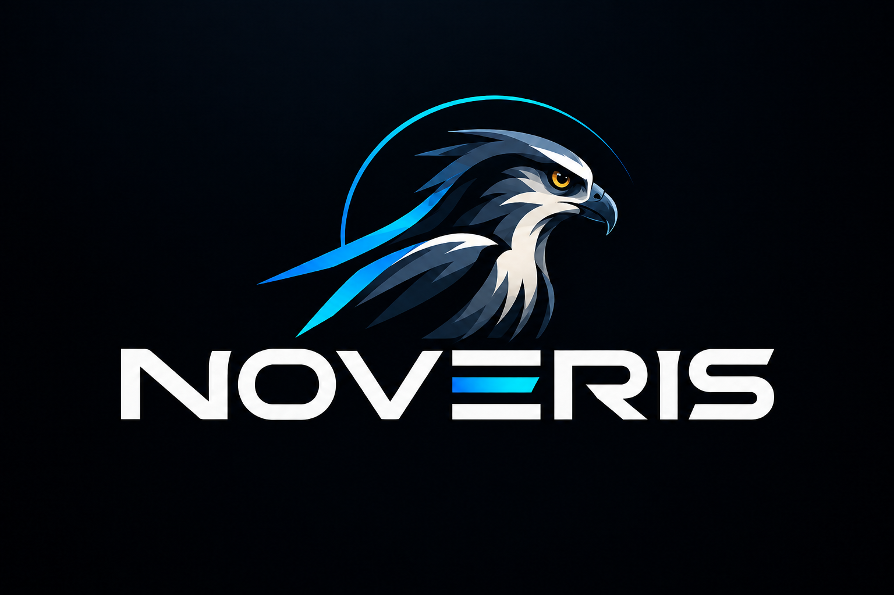
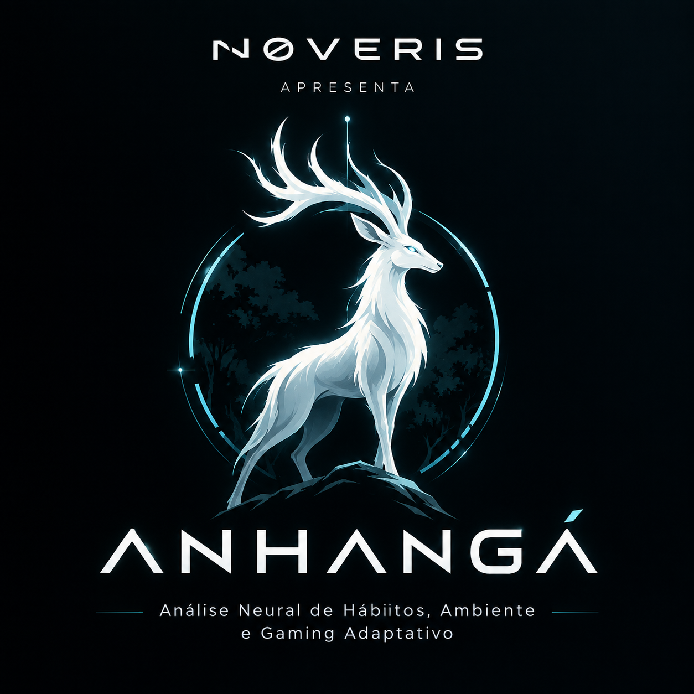

  <!-- Logo da Empresa (NOVERIS) -->
  
  
  
<b>A P R E S E N T A</b>

  <!-- Banner/Logo da IA (ANHANGÁ) -->
  

  # 🦅 ANHANGÁ
  ### Análise Neural de Hábitos, Ambiente e Gaming Adaptativo

  *Uma tecnologia inteligente que evolui com as pessoas.*

  

    <a href="#-nossa-história--a-noveris">História</a> •
    <a href="#-nossa-trajetória-20242030">Trajetória</a> •
    <a href="#-o-nascimento-do-anhangá">O ANHANGÁ</a> •
    <a href="#-por-que-escolhemos-o-nome-anhangá">Curiosidade</a> •
    <a href="#-como-funciona-na-prática--ia">Funcionamento</a> •
    <a href="#-matemática-aplicada--z-score">Matemática</a> •
    <a href="#-engenharia-de-dados">Engenharia</a> •
    <a href="#-modalidades-comerciais">Modalidades</a> •
    <a href="#-acessibilidade">Acessibilidade</a> •
    <a href="#-tecnologias">Tecnologias</a>
  

  <!-- Badges de Status e Contexto Institucional -->
  

    
    
    
    
  

  

    
    
    
  

---

## 🚀 Nossa História: A NOVERIS

A **NOVERIS** nasceu em **2024** a partir de uma indagação fundamental: *E se a tecnologia pudesse compreender não apenas o que fazemos, mas também o ambiente em que vivemos e a maneira como interagimos com o mundo digital?*

### O Significado do Nome NOVERIS
- **NOV:** A ideia de novidade, inovação e transformação.
- **ERIS:** A identidade futurista de uma empresa que explora novas possibilidades tecnológicas.

> **Lema oficial:** *NOVERIS — Inteligência que acompanha sua evolução.*

---

## 📅 Nossa Trajetória (2024–2030)

- **2024 — O nascimento da NOVERIS:** Fundação da empresa e início da jornada em IA e dados.
- **2025 — Construindo nossa identidade:** Evolução focada em inteligência artificial, software e acessibilidade.
- **2026 — O nascimento do ANHANGÁ:** Desenvolvimento da plataforma inteligente para gaming e telemetria ambiental.
- **2027 — Nossa próxima evolução:** Integração com dispositivos inteligentes (IoT) e automação de ambientes.
- **2030 — Nossa visão de futuro:** Expansão do ecossistema NOVERIS para novos horizontes tecnológicos.

---

## 🎯 O Nascimento do ANHANGÁ

O primeiro grande projeto da NOVERIS surgiu da observação do hábito dos jogadores: a perda da noção do tempo e da qualidade do ambiente (iluminação, ruído, temperatura e ausência de pausas).

O **ANHANGÁ** é o assistente inteligente desenvolvido para monitorar sessões de jogo, registrar o tempo dedicado, analisar pausas e medir temperatura, luminosidade, umidade e ruído, transformando dados brutos em inteligência adaptativa.

---

## 💡 Por que escolhemos o nome ANHANGÁ?

> Na mitologia e no folclore brasileiro tupi, o **Anhangá** é o espírito protetor da fauna e das florestas. Ele atua como um **guardião invisível e adaptativo**.

A **NOVERIS** adotou essa inspiração como símbolo de cuidado e equilíbrio: o **ANHANGÁ** protege o equilíbrio entre o jogador, seus hábitos e o ambiente doméstico. O sistema não proíbe a prática de jogar, mas incentiva o jogo consciente, atuando de maneira discreta e respeitosa.

---

## 💡 Curiosidades: Você Sabia?

1. **A NOVERIS foi fundada em 2024**, mas seu projeto principal (ANHANGÁ) ganhou estrutura em 2026.
2. **O nome ANHANGÁ** representa guarda silenciosa e acompanhamento sem imposições coercitivas.
3. **Autonomia mantida:** O aplicativo não toma decisões pelo jogador; fornece dados para a sua própria gestão.
4. **Acessibilidade nativa:** A inclusão visual, auditiva e motora foi projetada desde a primeira linha de código.

---

## 🧠 Como Funciona na Prática & IA

O sistema não opera com limites universais arbitrários (`if duracao > 120`). Ele aprende a linha de base individual do usuário para responder: **“O que é normal para este usuário?”**

$$\text{Dados} \longrightarrow \text{Processamento} \longrightarrow \text{Machine Learning (Z-Score)} \longrightarrow \text{Contexto} \longrightarrow \text{IA Generativa} \longrightarrow \text{Recomendação}$$

---

## 🧮 Matemática Aplicada & Z-Score

Para mensurar estatisticamente os desvios comportamentais, o ANHANGÁ aplica a fórmula:

$$Z = \frac{X - \mu}{\sigma}$$

Onde $X$ é a duração atual, $\mu$ é a média histórica e $\sigma$ é o desvio padrão. Se o **Z-Score** for muito elevado, a IA Generativa traduz a anomalia estatística em uma recomendação clara e amigável:

> 💡 *"Sua sessão atual está muito acima da sua duração habitual. Como você possui um compromisso próximo às 19:00, considere fazer uma pausa ou encerrar a sessão."*

---

## 💼 Modalidades Comerciais

1. **ANHANGÁ Free:** Acompanhamento gratuito de sessões, histórico, controle de tempo e indicadores básicos.
2. **ANHANGÁ Plus:** Assinatura com relatórios avançados de Machine Learning e alertas preditivos por IA.
3. **ANHANGÁ Connect:** Integração completa com automação de Smart Home e dispositivos IoT compatíveis.

---

## ♿ Acessibilidade como Inovação

- Paletas de cores para daltonismo (Protanopia, Deuteranopia, Tritanopia).
- Modos de Alto Contraste e regulagem do tamanho do texto.
- Alertas visuais, sonoros e hápticos personalizáveis.
- Suporte e adaptação para Libras e redução de estímulos visuais na fadiga.

---

## 🏗️ Engenharia de Dados

$$\mathbf{SOURCE} \longrightarrow \mathbf{INGESTION} \longrightarrow \mathbf{PROCESSING} \longrightarrow \mathbf{STORAGE} \longrightarrow \mathbf{CONSUMPTION}$$

1. **SOURCE:** Captura telemétrica da aplicação, jogos, sensores IoT e ambiente.
2. **INGESTION:** Entrada e organização dos dados telemétricos em tempo real.
3. **PROCESSING:** Processamento de arrays com Pandas/NumPy e cálculo de Z-Score.
4. **STORAGE:** Armazenamento relacional historizado no PostgreSQL / Supabase.
5. **CONSUMPTION:** Dashboards executivos e respostas contextualizadas via IA.

---

## 🚀 Tecnologias

- **Python 3.11+** | **FastAPI** | **Pandas & NumPy**
- **Scikit-learn** | **PostgreSQL / Supabase** | **Git / GitHub Pages**

---

## 🌐 O Futuro da NOVERIS

A NOVERIS expandirá sua tecnologia para produtividade, acessibilidade e automação residencial inteligente.

  
<b>NOVERIS — O futuro não é apenas inteligente. Ele precisa ser humano.</b>

  
NOVERIS © 2024–2026 • ExpoTech 2026.2 • Missão 2050 🌌

