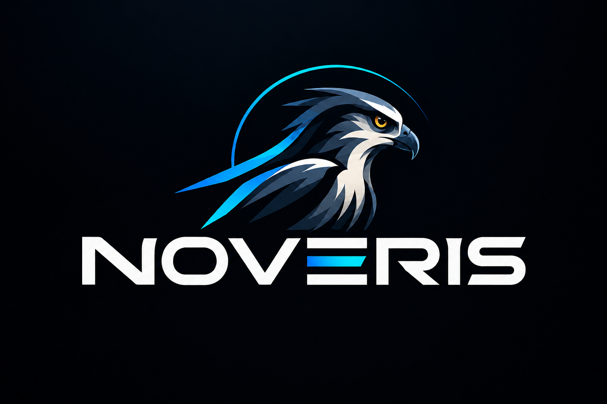
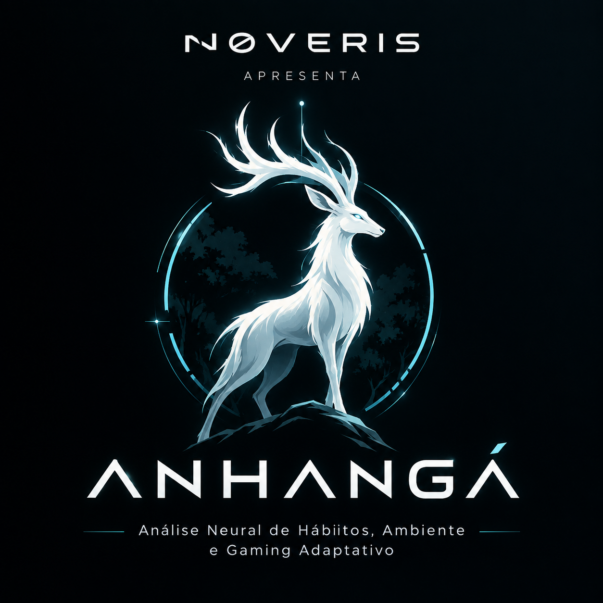

  <!-- Logo da Empresa (NOVERIS) -->
  
  
  
<b>A P R E S E N T A</b>

  <!-- Banner/Logo da IA (ANHANGÁ) -->
  

  # 🦅 ANHANGÁ Mobile
  ### Análise Neural de Hábitos, Ambiente e Gaming Adaptativo

  *Tecnologia que entende seu ritmo. Desenvolvido pela NOVERIS.*

  

    <a href="#-sobre-a-noveris">Sobre</a> •
    <a href="#-o-produto-anhangá-mobile">ANHANGÁ</a> •
    <a href="#-mitologia--origem-do-nome">Mitologia</a> •
    <a href="#-história-do-desenvolvimento">Desenvolvimento</a> •
    <a href="#-funcionalidades-do-aplicativo">Funcionalidades</a> •
    <a href="#-inteligência-artificial--anhangá-predictor">Machine Learning</a> •
    <a href="#-arquitetura-de-dados">Arquitetura</a> •
    <a href="#-situação-atual--roadmap">Roadmap</a>
  

  <!-- Badges -->
  

    
    
    
    
  

---

## 🏢 Sobre a NOVERIS

A **NOVERIS** é uma empresa de tecnologia focada em inteligência artificial, ciência de dados e desenvolvimento de software, dedicada a criar soluções inteligentes, acessíveis e personalizadas que melhoram experiências digitais.

* **Missão:** Desenvolver soluções inteligentes, acessíveis e personalizadas que melhorem experiências digitais e promovam a autonomia do usuário com total transparência e responsabilidade.
* **Visão:** Ser referência em inovação, desenvolvimento de software e inteligência artificial aplicada.
* **Valores:** Inovação, Acessibilidade, Privacidade, Transparência, IA Responsável, Personalização e Melhoria contínua.
* **Lema:** *"NOVERIS — Inteligência que acompanha sua evolução."*

---

## 📱 O Produto: ANHANGÁ Mobile

O **ANHANGÁ Mobile** é o principal ecossistema mobile da NOVERIS, voltado ao monitoramento inteligente de hábitos gamer, tempo de jogo, pausas, condições ambientais, acessibilidade e inteligência analítica.

> *Nota importante:* O sistema oferece informações, estatísticas detalhadas e recomendações, atuando de forma consultiva e mantendo o controle total nas mãos do jogador.

---

## 💡 Mitologia & Origem do Nome

O nome **ANHANGÁ** foi inspirado em tradições indígenas brasileiras, onde em algumas narrativas é associado à proteção dos animais e das matas, podendo aparecer como um veado branco de olhos luminosos. A NOVERIS criou uma interpretação artística e autoral futurista:
* **Olhos Luminosos:** Percepção apurada do ambiente.
* **Chifres:** Conexão lógica entre informações telemétricas e o histórico.
* **Cervo:** Atenção constante ao ecossistema e equilíbrio dinâmico.
* **Estética Futurista:** Fusão entre ancestralidade cultural e vanguarda tecnológica.

*(Nota: Trata-se de uma interpretação artística do projeto; as tradições indígenas possuem múltiplas e ricas variações culturais que devem ser respeitadas).*

---

## 🛠️ História do Desenvolvimento

O projeto evoluiu através de fases metodológicas estruturadas:

* **Fase 1 (Python + FastAPI + Supabase PostgreSQL):** Construção da API base para cadastro, sessões e análises em `http://127.0.0.1:8000/docs`. Integração com Supabase desde o início.
* **Fase 2 (Estatística com Python):** Implementação de cálculos de Média, Mediana, Desvio Padrão, Z-score, Scores de anomalia e recomendações ambientais.
* **Fase 3 (Machine Learning & Edge Functions):** Desenvolvimento de modelo experimental de regressão logística para estimar o risco de prolongamento das partidas.
* **Fase 4 (Flutter + Dart + Kotlin + Supabase):** Desenvolvimento do aplicativo Android com histórico, estatísticas, jogos instalados e relógio flutuante (validado no Samsung Galaxy A56 com Android 16).
* **Fase 5 (Agenda Inteligente & Meu Quarto):** Integração de acessibilidade avançada, simulação de ambiente virtual via Supabase Realtime e leitura de compromissos autorizados.

---

## ⚙️ Funcionalidades do Aplicativo

1. **Relógio Flutuante (Kotlin):** Cronômetro sobre outros aplicativos, tempo decorrido/restante, pausa, minimização, avisos de limite e sincronização local.
2. **Meu Ritmo:** Estatísticas de partidas registradas, tempo total, médio, habitual, variações, sessões curtas/longas e histórico.
3. **Partidas:** Histórico individual por jogo, plataforma, horário, duração, limite, pausas e resultados de análises.
4. **Agenda Inteligente:** Consulta compromissos autorizados do calendário Android para correlacionar eventos ao limite de tempo.
5. **Meu Quarto:** Simulação de ambiente gamer virtual (luz, temperatura, umidade, ruído, personagem) com comunicação via Supabase Realtime.
6. **Acessibilidade:** Alto contraste, paletas para daltonismo, tipografia customizável e linguagem amigável.

---

## 🤖 Inteligência Artificial — ANHANGÁ Predictor

Modelo experimental de **Regressão Logística** desenvolvido para estimar o risco de uma sessão ultrapassar o limite de tempo definido pelo jogador.

* **Métricas de Validação (Dados Sintéticos):**
  * **Acurácia:** 83,00%
  * **Precisão:** 86,62%
  * **Recall:** 89,13%
  * **F1-Score:** 87,86%
  *(Treinamento: 1.600 amostras | Teste: 400 amostras)*

---

## 🏗️ Arquitetura de Dados (Supabase PostgreSQL)

O projeto utiliza uma arquitetura relacional robusta dividida em tabelas dimensionais e de fatos:
* `dim_usuario`, `dim_jogo`, `dim_dispositivo`, `dim_ambiente`, `dim_tempo`, `dim_modelo_ia`
* `fato_ia`, `fato_acao_ia`, `fato_avaliacao_modelo`

**Fluxo Operacional:**
$$\text{Jogador} \longrightarrow \text{App Flutter} \longrightarrow \text{Kotlin & Supabase} \longrightarrow \text{PostgreSQL & Edge Functions} \longrightarrow \text{Insights no App}$$

---

## 🚀 Situação Atual & Roadmap

* **Implementado e Testado:** App Flutter no Android, relógio flutuante, histórico/estatísticas, backend FastAPI inicial com Supabase, comunicação virtual do Meu Quarto.
* **Em Validação:** Integração automática da agenda, alertas em segundo plano, refinamento de indicadores visuais.
* **Planejado:** Conclusão da agenda integrada ao Meu Quarto, automação física com dispositivos IoT, expansão de acessibilidade e testes com dados reais autorizados.

---

  
<b>NOVERIS © 2024–2026 • Inteligência que entende seu ritmo.</b>

